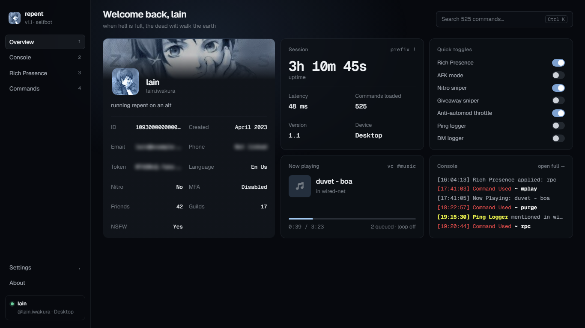
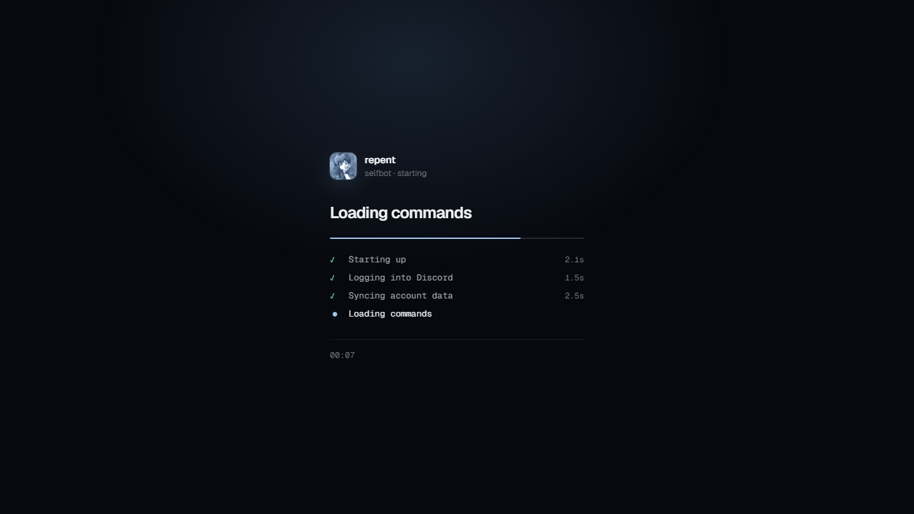
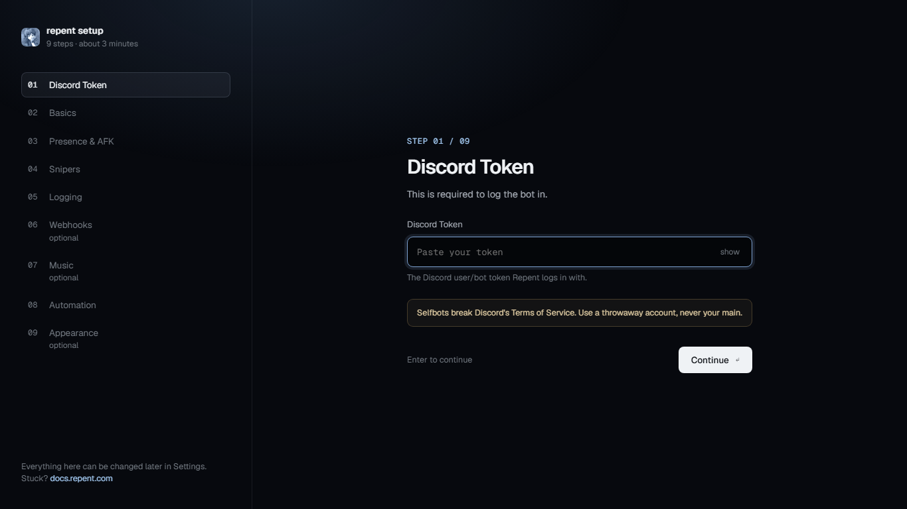
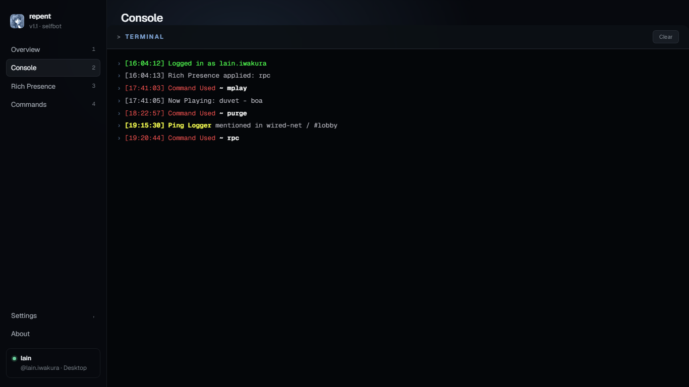
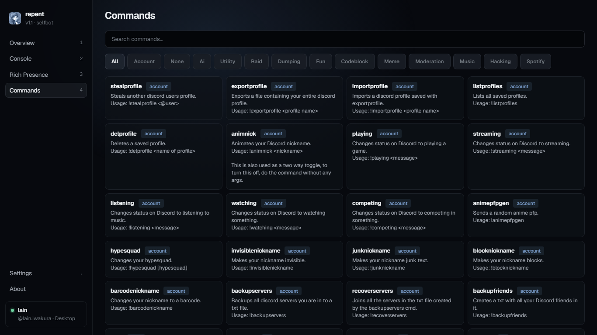
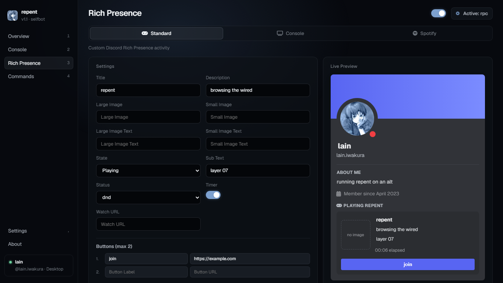
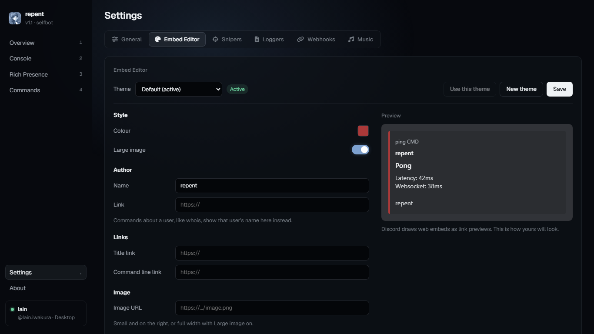
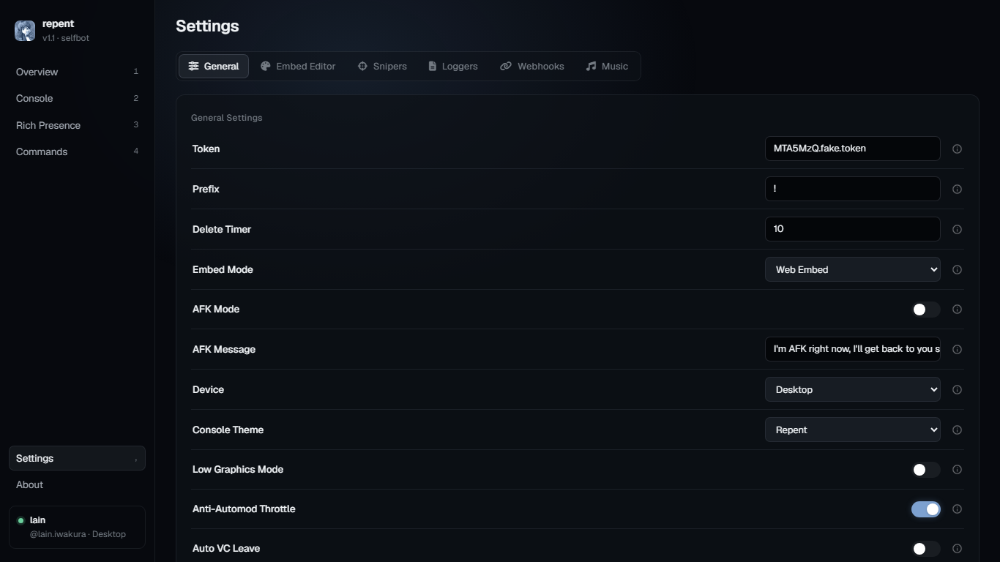

# repent

repent is a Discord selfbot with 500+ commands and a dashboard you control from your browser. It's a fork of [Cheddlatron](https://github.com/Cheddlar/Cheddlatron-Source). Current version: **1.1**.

> [!WARNING]
> Selfbots break [Discord's Terms of Service](https://discord.com/terms) and can get the account banned. Only use repent on an account you're okay with losing, never your main.



## What it does

- **500+ commands**: account tools, utility, fun, memes, moderation, AI images, music and more
- **Dashboard** at `http://localhost:6767`: see your account, the live console, every command, and all settings in one place
- **Rich Presence**: make a custom Discord status, with a live preview
- **Web embeds**: command replies show up as clean embeds, styled in the Embed Editor
- **Music**: play YouTube in a voice channel or on your PC's speakers
- **Snipers and loggers**: Nitro and giveaway sniper, ping, DM and friend loggers, with webhook alerts

## Install

You need [Python 3.10 or newer](https://www.python.org/downloads/).

1. Download repent and open a terminal in its folder.
2. Install what it needs:
   ```
   pip install -r req.txt
   ```
3. Start it:
   ```
   python repent.py
   ```

The first time, a setup page opens in your browser. Paste your Discord token, answer a few questions, and the dashboard opens when you're done. Everything can be changed later in **Settings**.

## Using the dashboard

| Page | What's there |
| --- | --- |
| **Overview** | Your account, uptime, now playing, quick on/off switches |
| **Console** | Everything repent prints, live |
| **Rich Presence** | Build your custom status |
| **Commands** | Search every command |
| **Settings** | General options, Embed Editor, snipers, loggers, webhooks, music |

Shortcuts: `1` to `4` switch pages, `,` opens Settings, `Ctrl+K` searches commands.

To run a command, type your prefix and the command name in any Discord chat, for example `.ping`. The default prefix is `.`.

## Music

1. Install [ffmpeg](https://ffmpeg.org/download.html) and make sure it's on your `PATH`.
2. Join a voice channel and type `.mplay <song name or link>`.

Other music commands: `mskip`, `mstop`, `mqueue`, `mnowplaying`, `mloop`, `mautoplay`, `mvolume`.

- **Play on your PC instead:** type `.moutput speakers`. Use `.moutput vc` to switch back.
- **Use it as a music bot for your main:** Discord only allows one voice connection per account, so run repent on an alt. In the alt's dashboard, go to **Settings → Music** and add your main's user ID to **Music Whitelist**. Your main can then use the music commands, and nothing else, in any server the alt is in.
- **Age-restricted videos:** load the Chrome extension in `extras/musicbot-cookie-sync/extension/` (open `chrome://extensions`, turn on Developer mode, click **Load unpacked**). In its options, set the server to `http://127.0.0.1:8999` and the domain to `youtube.com`.

## Optional: set defaults before the first run

Edit `preconfig.json` before you start repent for the first time, and setup will only ask for your token. Set any value to `null` to be asked for it instead. After the first run your settings live in `data/settings/configs/config.json`, and the dashboard is the easiest way to change them.

Two settings you might want:

- `dashboard_port`: the dashboard's port (default `6767`). Change it if something else is using that port.
- `dashboard_open_browser`: set to `false` to stop repent from opening your browser.

## Screenshots

These use a sample account, not real data.

| | |
| --- | --- |
|  Loading screen |  First-run setup |
|  Console |  Commands |
|  Rich Presence |  Embed Editor |
|  Settings | |

## Credits
- [21morgue](https://github.com/yungturtle): head developer 
- [Keira](https://github.com/KeiraOMG0): sponsoring Claude Code and the CDN server, and making this project possible
- [Grabify](https://github.com/Gr4bify/): retired Cheddlatron developer, helped fix the bot
- [Cheddlar](https://github.com/Cheddlar): retired Cheddlatron developer
- Wraith: retired Cheddlatron developer

